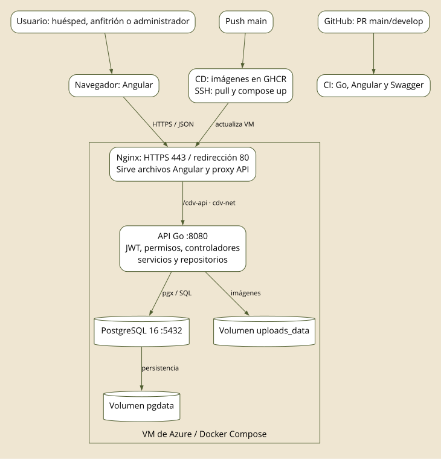
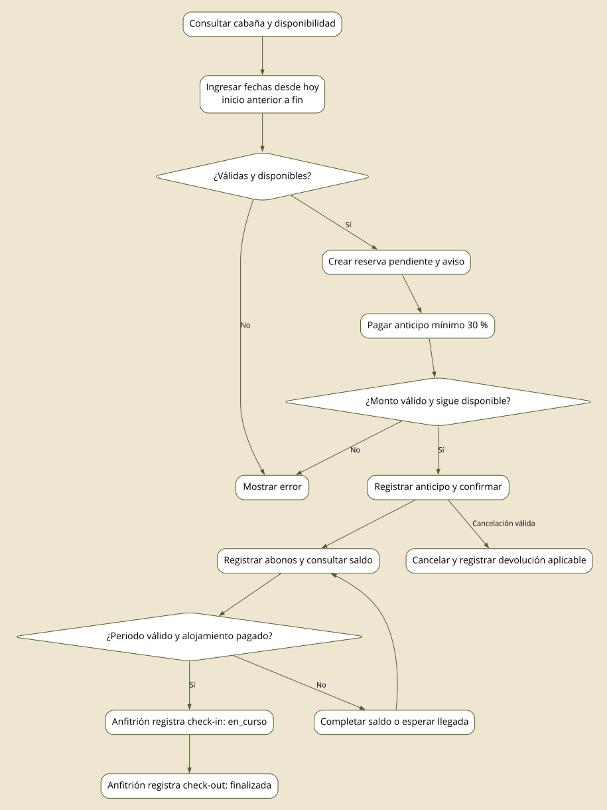
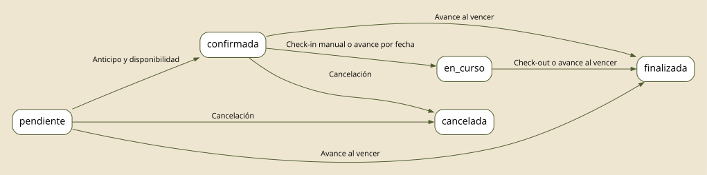
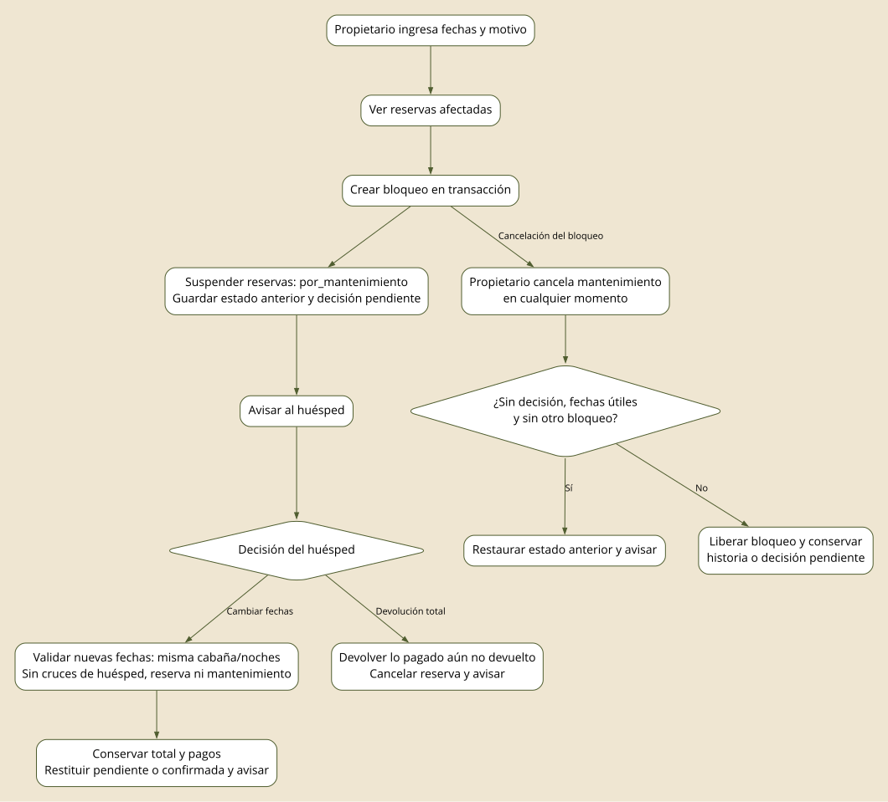

# Diagramas del sistema

Los ER se derivan de `database/init.sql` y de las migraciones del SHA de main fijado en el índice. Se separan por dominio para mantenerlos legibles. Las imágenes SVG se generaron con Graphviz a partir del mismo modelo. Son diagramas lógicos con atributos clave, no una exportación exhaustiva de cada columna ni una inspección de la base desplegada.

## Arquitectura de ejecución y entrega: main

Fuentes editables: [Mermaid](diagramas/arquitectura.mmd) · [Graphviz](diagramas/arquitectura.dot).

El Compose de producción publica Nginx en 80/443 y mantiene API y PostgreSQL en la red Docker. El diagrama no afirma que se hayan inspeccionado reglas externas del firewall ni el estado actual del certificado.

El backend organiza cada módulo en controlador HTTP, servicio de negocio y repositorio SQL. `cmd/api/main.go` conecta las dependencias y rutas. Angular organiza páginas, componentes, servicios, modelos, guards e interceptores. Los guards ayudan a la navegación; la autorización efectiva también debe aplicarse en la API.

CI se ejecuta en PR hacia main/develop. CD responde al push a main, publica imágenes con SHA y `latest`, y usa SSH para actualizar la VM. El workflow actual no declara CI como dependencia interna del job de despliegue.

## Proceso de reserva y estadía: main

Fuentes editables: [Mermaid](diagramas/proceso-reserva.mmd) · [Graphviz](diagramas/proceso-reserva.dot).

Las reservas pendientes no garantizan exclusividad en main; disponibilidad se revisa al confirmar. Los importes del flujo en main todavía dependen de tarifa base en varios puntos.

## Estados de reserva: main

Fuentes editables: [Mermaid](diagramas/estados-reserva.mmd) · [Graphviz](diagramas/estados-reserva.dot).

La API ejecuta una tarea al arrancar y luego cada seis horas. Pasa reservas confirmadas a `en_curso` cuando su periodo ha iniciado y finaliza reservas pendientes, confirmadas o en curso cuya fecha de fin ya pasó. Al finalizar rellena marcas de llegada/salida si faltan. Además, la migración 004 define un job de pg_cron cada quince minutos que solo se instala si la extensión y su base están configuradas. Desarrollo usa una imagen con pg_cron; producción declara PostgreSQL estándar y no acredita ese job.

## Proceso de mantenimiento

Fuentes editables: [Mermaid](diagramas/proceso-mantenimiento.mmd) · [Graphviz](diagramas/proceso-mantenimiento.dot).
