# Manual de Usuario: Anfitrión

## Casa Del Valle

Esta guía explica cómo usar Casa Del Valle con el rol de **anfitrión**: convertir tu cuenta, publicar cabañas, administrar imágenes y precios, atender reservaciones, registrar pagos y consultar tus ingresos.

> Moneda: quetzales (GTQ). Las fechas y horarios se muestran en formato local de Guatemala.

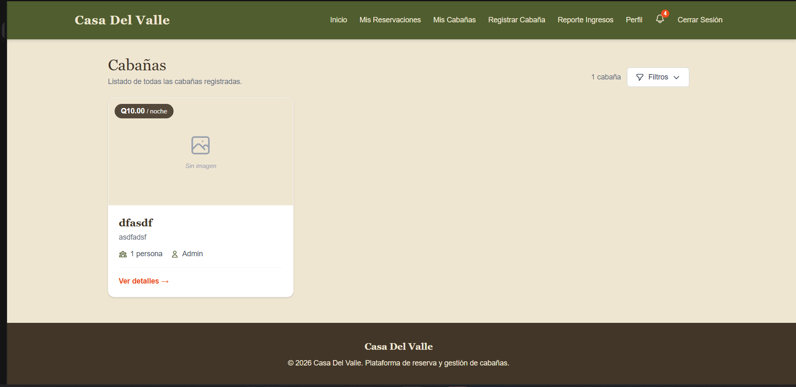

## 1. Antes de comenzar

Para ser anfitrión necesitas:

- Una cuenta registrada en Casa Del Valle.
- Haber iniciado sesión.
- Convertir tu cuenta de huésped a anfitrión (cambio permanente).
- Los datos de la propiedad que vas a publicar: nombre, dirección, precio por noche, capacidad, descripción y reglas.

Con el rol de anfitrión puedes:

- Publicar y administrar tus propias cabañas.
- Subir y eliminar imágenes de tus cabañas.
- Configurar precios por temporada para tus cabañas.
- Ver las reservaciones de tus cabañas.
- Registrar pagos, check-in, check-out y reembolsos.
- Consultar tu reporte de ingresos.
- Recibir notificaciones de reservaciones, pagos y cuenta.

No puedes editar cabañas de otros anfitriones ni administrar las temporadas globales del sistema; esas funciones corresponden al administrador.

## 2. Iniciar sesión y conocer el menú

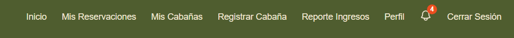

1. Abre la aplicación.
2. Selecciona **Inicio de sesión** o **Registro** si aún no tienes cuenta.
3. Ingresa tu correo y contraseña.

Al iniciar sesión como anfitrión, la barra superior muestra:

| Opción | Para qué sirve |
| --- | --- |
| **Inicio** | Ver el catálogo de cabañas y buscar propiedades. |
| **Mis Reservaciones** | Consultar las reservaciones que hiciste como huésped. No administra las reservaciones de tus cabañas. |
| **Mis Cabañas** | Ver y administrar las cabañas que publicaste. |
| **Registrar Cabaña** | Publicar una nueva cabaña. |
| **Reporte Ingresos** | Consultar pagos, anticipos y reembolsos de tus cabañas. |
| **Perfil** | Ver y actualizar tus datos personales. |
| **Campana** | Abrir tus notificaciones. |
| **Cerrar Sesión** | Salir de tu cuenta. |

## 3. Convertirte en anfitrión

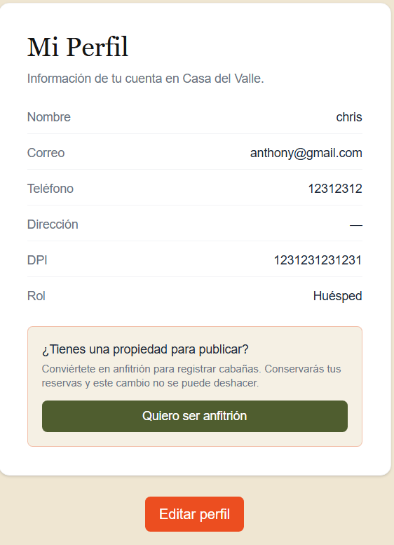

Si tu cuenta es de tipo huésped:

1. Abre **Perfil**.
2. En la tarjeta **¿Tienes una propiedad para publicar?**, selecciona **Quiero ser anfitrión**.
3. Confirma la acción en el mensaje de advertencia.
4. Espera el mensaje de confirmación.

El cambio es permanente y conserva tus reservaciones anteriores. Después de convertirte, aparecen en el menú **Mis Cabañas**, **Registrar Cabaña** y **Reporte Ingresos**.

## 4. Registrar tu primera cabaña

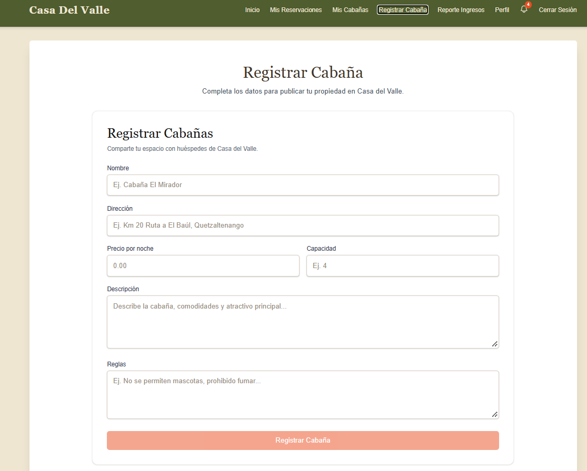

1. En el menú superior selecciona **Registrar Cabaña**.
2. Completa el formulario.
3. Revisa los datos y selecciona **Registrar Cabaña**.
4. Si el registro es correcto, verás el mensaje **¡Cabaña Registrada!** y serás redirigido a **Mis Cabañas**.

### Campos del formulario

| Campo | Obligatorio | Reglas |
| --- | --- | --- |
| **Nombre** | Sí | Entre 3 y 150 caracteres. Puede incluir letras, números, espacios y los signos `- . ' #`. |
| **Dirección** | Sí | Entre 5 y 255 caracteres. |
| **Precio por noche** | Sí | Mayor o igual a 0. |
| **Capacidad** | Sí | Entre 1 y 50 personas. |
| **Descripción** | No | Máximo 500 caracteres. |
| **Reglas** | No | Máximo 500 caracteres. Se recomienda indicar mascotas, fumado, horarios y normas de convivencia. |

Si falta un dato o no cumple las reglas, el formulario muestra el error y no permite guardar hasta corregirlo.

> La cabaña se publica sin imágenes. Después de crearla, edítala para subir fotos.

## 5. Administrar tus cabañas

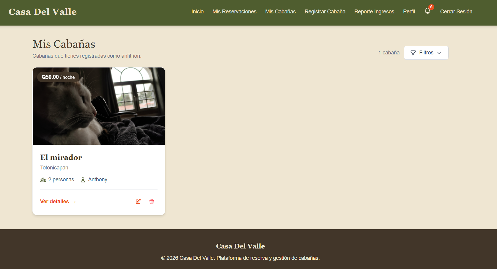

Abre **Mis Cabañas** para ver únicamente las propiedades registradas con tu cuenta.

Cada tarjeta muestra la imagen principal, el precio por noche, el nombre, la dirección, la capacidad y el anfitrión. Desde la tarjeta puedes:

- Seleccionar la cabaña o **Ver detalles** para abrir su ficha.
- Usar el icono de lápiz para **Editar**.
- Usar el icono de basura para **Eliminar**.

La eliminación es permanente y solicita confirmación. Antes de eliminar una cabaña, revisa si tiene reservaciones activas o historial que necesites conservar.

## 6. Editar la información de una cabaña

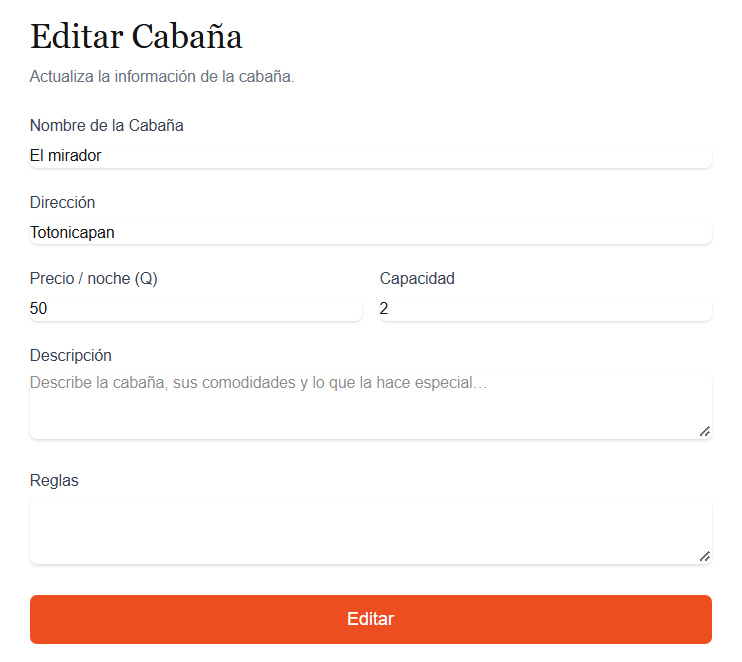

1. En **Mis Cabañas**, selecciona el icono de edición de la cabaña.
2. Actualiza los campos que necesites.
3. Selecciona **Editar**.
4. Espera el mensaje **¡Cabaña actualizada correctamente!**.

Puedes cambiar nombre, dirección, precio base por noche, capacidad, descripción y reglas. El precio base debe ser mayor que cero al editar.

Solo el propietario de la cabaña o un administrador puede editarla o eliminarla.

## 7. Subir y administrar imágenes

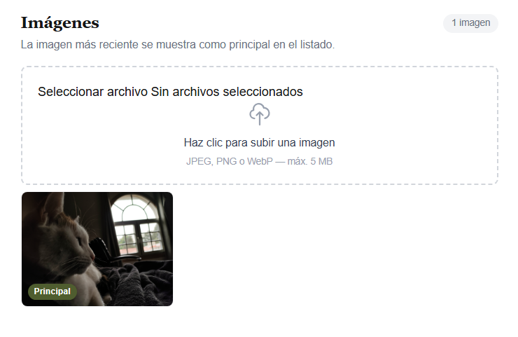

Las imágenes se administran desde la pantalla de edición de la cabaña, en la sección **Imágenes**.

1. Abre la cabaña y entra a **Editar**.
2. En **Imágenes**, selecciona **Haz clic para subir una imagen**.
3. Elige un archivo JPEG, PNG o WebP de máximo 5 MB.
4. Espera a que termine la carga.
 
Recomendaciones:

- Sube fotos horizontales y con buena iluminación.
- Incluye la fachada, habitaciones, baños y áreas comunes.
- La imagen más reciente se muestra como **Principal** en el catálogo. Si quieres cambiar la principal, sube primero las secundarias y al final la que deseas destacar.
- Para eliminar una imagen, pasa el cursor sobre ella y usa el botón de basura. El sistema solicita confirmación.

Si el archivo no es JPEG, PNG o WebP, o supera 5 MB, la aplicación muestra un error y no lo sube.

## 8. Configurar precios por temporada

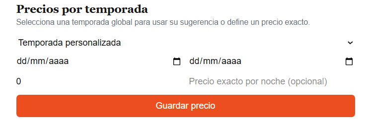

En la pantalla de edición de la cabaña encontrarás la sección **Precios por temporada**. Sirve para definir tarifas especiales para rangos de fechas.

### Opción A: usar una temporada global

1. En **Temporada**, selecciona una temporada creada por el administrador, por ejemplo Navidad o Semana Santa.
2. El sistema completa automáticamente las fechas y el porcentaje sugerido.
3. Ajusta el porcentaje o el precio exacto si lo necesitas.
4. Selecciona **Guardar precio**.

### Opción B: crear un rango personalizado

1. Deja la opción **Temporada personalizada**.
2. Indica la fecha de inicio y la fecha de fin.
3. Escribe un ajuste porcentual o un precio exacto por noche.
4. Selecciona **Guardar precio**.

### Campos

| Campo | Uso |
| --- | --- |
| **Temporada** | Temporada global de referencia o precio personalizado. |
| **Fecha de inicio** | Primer día del rango con tarifa especial. |
| **Fecha de fin** | Día de salida del rango; la noche de esa fecha no se cobra. |
| **Ajuste porcentual** | Porcentaje que se suma al precio base, entre 0 y 100. Es obligatorio; si usas un precio exacto, puedes dejarlo en 0. |
| **Precio exacto por noche** | Tarifa fija opcional. Si se indica, tiene prioridad sobre el porcentaje. |

Reglas de validación:

- La fecha de fin no puede ser anterior a la fecha de inicio.
- El precio exacto, si se usa, debe ser mayor que cero.
- Para eliminar una tarifa configurada, usa **Eliminar** y confirma la acción.

Prioridad de cálculo para una cotización por noche:

1. Precio exacto configurado para la cabaña.
2. Porcentaje configurado para la cabaña.
3. Un ajuste de 0 % en la cabaña anula la temporada global para ese rango.
4. Temporada global activa.
5. Precio base de la cabaña.

> **Importante:** en esta versión, los precios por temporada se usan para cotizaciones. El total de una reservación creada desde la aplicación todavía se calcula con el precio base de la cabaña. Revisa el total antes de confirmar y no supongas que el ajuste por temporada ya está incluido en la reservación.

## 9. Ver las reservaciones de tus cabañas

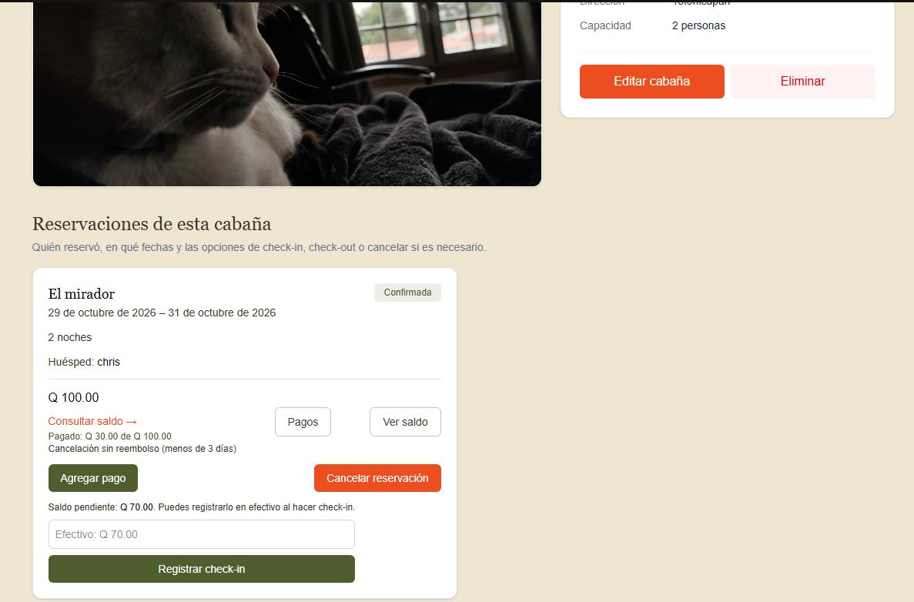

Las reservaciones de tus propiedades no se administran desde **Mis Reservaciones**. Ese apartado muestra las reservaciones que tú hiciste como huésped.

Para ver las reservaciones de una cabaña:

1. Abre **Mis Cabañas**.
2. Selecciona la cabaña para abrir su detalle.
3. Baja hasta **Reservaciones de esta cabaña**.

Solo el propietario o un administrador puede ver esta sección. Cada tarjeta de reservación muestra:

- Cabaña y fechas de entrada y salida.
- Estado de la reservación.
- Cantidad de noches.
- Nombre del huésped.
- Total de la reservación.
- Monto pagado y enlace **Consultar saldo**.
- Anticipo requerido cuando está pendiente.
- Política de reembolso cuando está confirmada.

### Estados de una reservación

| Estado | Significado |
| --- | --- |
| **Pendiente** | Creada, pero aún no se ha pagado el anticipo mínimo. |
| **Confirmada** | El huésped pagó al menos el 30 % del total. |
| **En curso** | Se registró el check-in y la estadía está activa. |
| **Finalizada** | Se registró el check-out. |
| **Cancelada** | La reservación fue anulada. |

## 10. Pagos y anticipos

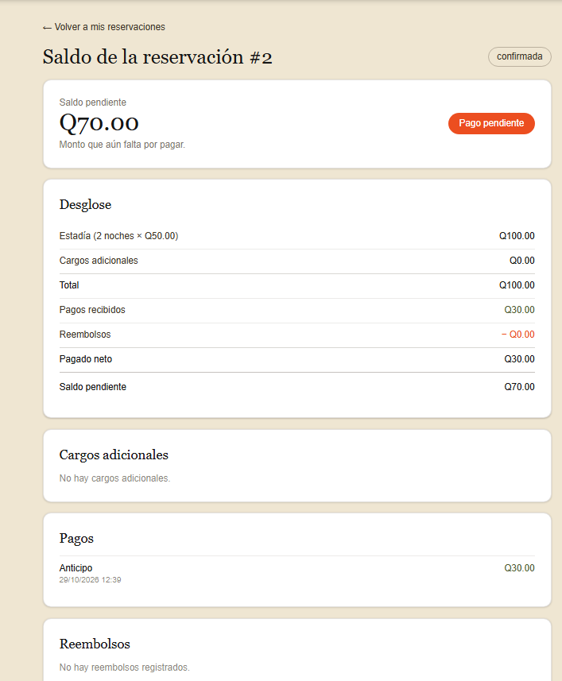

Para confirmar una reservación, el huésped debe pagar un anticipo mínimo del 30 % del total. El saldo restante debe cubrirse antes del check-in.

Desde la tarjeta puedes abrir **Pagos** para ver el total, lo pagado, el saldo pendiente y el historial. En reservaciones confirmadas o en curso también puedes usar **Agregar pago** para registrar un pago por un monto que no supere el saldo pendiente.

Métodos disponibles:

| Método | Cuándo se usa |
| --- | --- |
| **Tarjeta** | Pago registrado con tarjeta. |
| **Transferencia** | Pago registrado por transferencia. |
| **Efectivo (día del check-in)** | Pago en efectivo al recibir al huésped. |

No se pueden registrar pagos en reservaciones pendientes desde este módulo. Primero el huésped debe pagar el anticipo para que la reservación pase a confirmada.

El enlace **Consultar saldo** o **Ver saldo** abre el desglose de la estadía, cargos adicionales, pagos, reembolsos y saldo pendiente.

## 11. Registrar el check-in

El check-in confirma que el huésped llegó y que la estadía comienza.

Requisitos:

1. La reservación debe estar **Confirmada**.
2. La fecha actual debe estar dentro del rango de la reservación, desde la fecha de entrada hasta la fecha de salida.
3. El saldo debe estar completamente pagado.

Pasos:

1. Abre la cabaña y ubica la reservación.
2. Si queda saldo pendiente, puedes escribir el monto en efectivo. El monto debe cubrir exactamente el saldo.
3. Selecciona **Registrar check-in**.
4. Confirma la acción.

Si el pago está incompleto, la fecha está fuera del rango o la reservación no está confirmada, el sistema muestra un error y no registra el check-in.

Al completarlo, la reservación pasa a **En curso** y se envían notificaciones al huésped y al anfitrión.

## 12. Registrar el check-out

El check-out finaliza la estadía.

Requisitos:

1. La reservación debe estar **En curso**.
2. Debe existir un check-in registrado.

Pasos:

1. Abre la cabaña y ubica la reservación.
2. Revisa que el saldo esté en orden.
3. Selecciona **Registrar check-out**.
4. Confirma la acción.

Al completarlo, la reservación pasa a **Finalizada**. El check-out no genera reembolsos automáticamente.

## 13. Cancelaciones y reembolsos

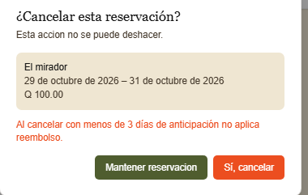

### Cancelar una reservación

Puedes cancelar reservaciones en estado **Pendiente** o **Confirmada** desde la tarjeta de la reservación.

1. Selecciona **Cancelar reservación**.
2. Revisa la advertencia y confirma.

La reservación pasa a **Cancelada**. Si corresponde un reembolso según la anticipación con que se cancela, el sistema lo registra y lo muestra en la tarjeta y en el historial financiero.

Criterios de reembolso sobre lo pagado:

| Anticipación | Reembolso |
| --- | --- |
| 7 días o más antes de la entrada | 100 % |
| Entre 3 y 6 días antes de la entrada | 70 % |
| Menos de 3 días antes de la entrada | Sin reembolso |

### Registrar un reembolso manual

En una reservación cancelada puedes usar **Registrar reembolso** para devolver un monto total o parcial del saldo disponible. El reembolso queda como un movimiento nuevo en el historial; el pago original no se elimina.

1. Abre **Registrar reembolso**.
2. Revisa el total pagado, lo ya reembolsado y el monto disponible.
3. Elige **Reembolso total** o **Reembolso parcial**.
4. Confirma la operación.

También puedes consultar **Historial financiero** para ver pagos y reembolsos de una reservación cancelada.

## 14. Consultar el reporte de ingresos

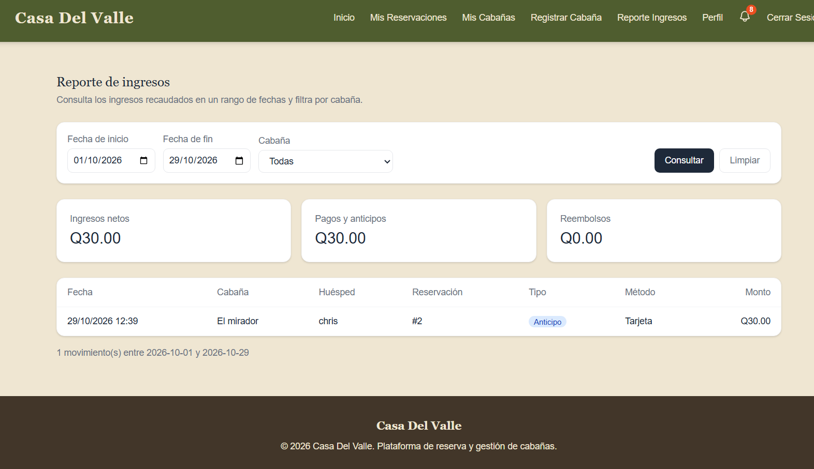

1. En el menú superior selecciona **Reporte Ingresos**.
2. Indica la fecha de inicio y la fecha de fin.
3. Selecciona una cabaña o deja **Todas**.
4. Selecciona **Consultar**.

El reporte muestra:

- **Ingresos netos**.
- **Pagos y anticipos**.
- **Reembolsos**.

La tabla de movimientos incluye fecha, cabaña, huésped, número de reservación, tipo de movimiento, método y monto. Los tipos posibles son **Anticipo**, **Pago** y **Reembolso**.

Si no hay movimientos en el rango seleccionado, el sistema muestra el mensaje **Sin registros**. Usa **Limpiar** para volver al rango predeterminado del mes actual.

## 15. Notificaciones

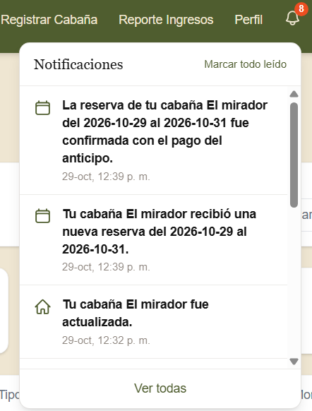

La campana de la barra superior muestra la cantidad de notificaciones sin leer.

1. Selecciona la campana para abrir la bandeja.
2. Filtra por **Todas** o **No leídas**.
3. Selecciona una notificación para marcarla como leída y abrir la pantalla relacionada.
4. Usa **Marcar todas como leídas** para limpiar el contador.
5. Si hay muchas notificaciones, usa **Cargar más**.

Recibirás avisos relacionados con reservaciones, pagos, cancelaciones, check-in, check-out, reembolsos, cabañas y cambios de cuenta. Revisa la bandeja con frecuencia para no perder una solicitud o un pago.

## 16. Actualizar tu perfil

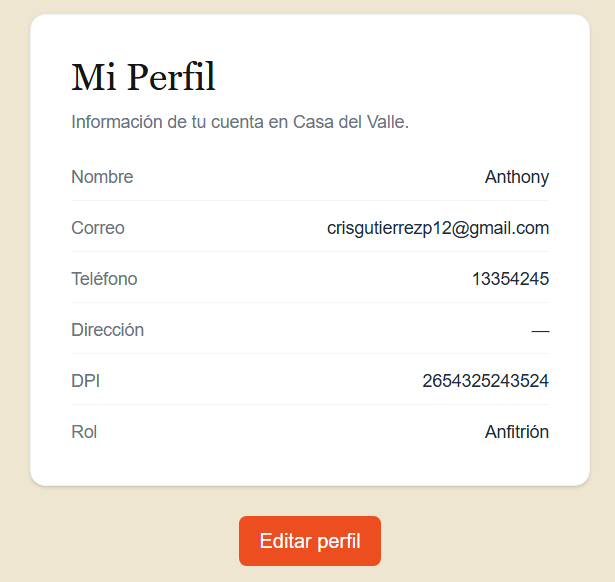

1. Abre **Perfil**.
2. Revisa nombre, correo, teléfono, dirección, DPI y rol.
3. Selecciona **Editar perfil**.
4. Actualiza los datos permitidos.
5. Selecciona **Guardar cambios**.

El DPI no se puede editar. El teléfono debe tener 8 dígitos y la dirección, si se indica, debe tener entre 5 y 255 caracteres.

Mantén actualizados tu correo y teléfono para que los huéspedes y el equipo puedan contactarte.

## 17. Preguntas frecuentes

**No veo Mis Cabañas, Registrar Cabaña ni Reporte Ingresos.**
Tu cuenta todavía es de huésped. Convierte tu cuenta desde **Perfil** con **Quiero ser anfitrión**.

**No puedo editar una cabaña.**
Solo el propietario de la cabaña o un administrador puede editarla. Verifica que hayas iniciado sesión con la cuenta correcta.

**No puedo registrar el check-in.**
Revisa que la reservación esté confirmada, que la fecha actual esté dentro de la estadía y que el saldo esté completamente pagado. Si cobras en efectivo, el monto debe ser exactamente igual al saldo pendiente.

**El botón de check-out no aparece.**
La reservación debe estar **En curso** y tener un check-in registrado.

**No puedo agregar un pago.**
Solo se registran pagos en reservaciones confirmadas o en curso, y el monto no puede superar el saldo pendiente. Las reservaciones pendientes primero deben recibir el anticipo del huésped.

**No puedo subir una imagen.**
Verifica que sea JPEG, PNG o WebP y que no supere 5 MB.

**Configuré un precio por temporada, pero el total de la reservación no cambió.**
En esta versión los precios por temporada se usan para cotizaciones y no se aplican automáticamente al total de las reservaciones creadas desde la aplicación. El total se calcula con el precio base de la cabaña.

**No veo las reservaciones de mi cabaña.**
Abre la cabaña desde **Mis Cabañas** y baja hasta **Reservaciones de esta cabaña**. **Mis Reservaciones** solo muestra tus propias estadías como huésped.

**La sesión se cerró o aparece un error de permisos.**
Vuelve a iniciar sesión. Si el problema continúa, contacta al administrador del sistema.

## 18. Buenas prácticas

- Publica al menos tres imágenes de buena calidad por cabaña.
- Mantén actualizados el precio base, la capacidad, la descripción y las reglas.
- Revisa las notificaciones y el reporte de ingresos cada día.
- Confirma los pagos antes de registrar el check-in.
- Registra el check-in y el check-out en la fecha correspondiente.
- No canceles reservaciones sin revisar la política de reembolso.
- No compartas tu contraseña ni uses una cuenta compartida.
- Si necesitas crear o modificar temporadas globales, solicítalo al administrador.

## 19. Glosario

| Término | Definición |
| --- | --- |
| **Anfitrión** | Usuario que publica y administra cabañas. |
| **Huésped** | Usuario que reserva una cabaña. |
| **Temporada global** | Rango de fechas y ajuste definido por el administrador para todo el sistema. |
| **Precio por temporada** | Tarifa especial configurada para una cabaña en un rango de fechas. |
| **Anticipo** | Pago mínimo del 30 % que confirma una reservación. |
| **Saldo** | Monto que falta por pagar de una reservación. |
| **Check-in** | Registro de llegada del huésped. |
| **Check-out** | Registro de salida y finalización de la estadía. |
| **Reembolso** | Devolución total o parcial de un pago. |
| **Ingreso neto** | Resultado de los pagos y anticipos menos los reembolsos en el periodo consultado. |
